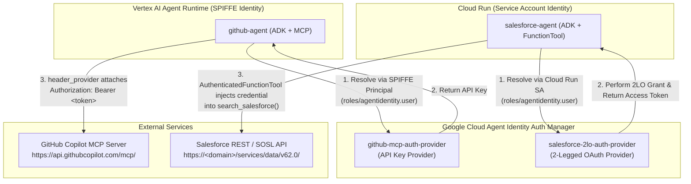

# Agent Identity Foundations — Step-by-Step Runbook & Documentation

This runbook documents the end-to-end implementation for refactoring enterprise ADK agents (`github-agent` on Vertex AI Agent Runtime and `salesforce-agent` on Cloud Run) to eliminate hardcoded secrets and authenticate via **Google Cloud Agent Identity Auth Manager**.

---

## Architecture Overview



| Agent | Runtime Target | Workload Identity Type | Auth Provider Type | ADK Delivery Mechanism |
| :--- | :--- | :--- | :--- | :--- |
| **`github-agent`** | Vertex AI Agent Runtime | Federated SPIFFE Principal (`principal://agents.global.org-...`) | API Key (`--api-key`) | `McpToolset` + `GcpAuthProviderScheme` + `header_provider` |
| **`salesforce-agent`** | Cloud Run | Service Account (`serviceAccount:...`) | 2-Legged OAuth (`--two-legged-oauth-*`) | `AuthenticatedFunctionTool` + `AuthConfig` + injected `credential: AuthCredential` |

---

## Task 1: Prepare the Environment for Agent Identity

### 1.1 Set Environment Variables
Configure the project, region, project number, and organization ID variables:

```bash
export PROJECT_ID=qwiklabs-gcp-01-f4786d987598
export LOCATION=us-central1
export REGION=us-central1

gcloud config set project ${PROJECT_ID}
export PROJECT_NUMBER=$(gcloud projects describe ${PROJECT_ID} --format='value(projectNumber)')
export ORGANIZATION_ID=$(gcloud projects get-ancestors ${PROJECT_ID} --format=json | jq -r '.[] | select(.type=="organization") | .id')

echo "Project: ${PROJECT_ID} (${PROJECT_NUMBER}), Org: ${ORGANIZATION_ID}, Location: ${LOCATION}, Agents: ${REGION}"
```

### 1.2 Download Setup Scripts and Starter Code
Copy the prerequisite scripts and agent code from the lab GCS bucket and install `agents-cli`:

```bash
gcloud storage cp -r gs://${PROJECT_ID}-bucket/apex_labs .
bash apex_labs/lab2_prereqs.sh
export PATH="$HOME/.local/bin:$PATH"
```

*(Note: If running non-interactively, install `uv` and `google-agents-cli==1.0.0`, copy `gs://${PROJECT_ID}-bucket/agents/*` to `~/agents/`, and ensure `acli_version: "1.0.0"` is set in each `agents-cli-manifest.yaml`.)*

### 1.3 Configure `github-agent/.env`
Create `~/agents/github-agent/.env` without any `GITHUB_PERSONAL_ACCESS_TOKEN`, referencing the Auth Provider resource URI instead:

```bash
cd ~/agents/github-agent
cat << EOF > .env
GOOGLE_CLOUD_PROJECT=$PROJECT_ID
GOOGLE_CLOUD_LOCATION=global
GOOGLE_GENAI_USE_VERTEXAI=True
MODEL=gemini-3.5-flash
GITHUB_MCP_URL=https://api.githubcopilot.com/mcp/
GITHUB_AUTH_PROVIDER_URI=projects/$PROJECT_ID/locations/$LOCATION/authProviders/github-mcp-auth-provider
EOF
```

### 1.4 Verify `agents-cli` Installation
```bash
agents-cli info
```

### 1.5 Enable Required Google Cloud APIs
Enable the IAM, Vertex AI, Security Token Service, and Agent Identity APIs:

```bash
gcloud services enable \
  iam.googleapis.com \
  agentidentity.googleapis.com \
  aiplatform.googleapis.com \
  agentidentitycredentials.googleapis.com \
  iamcredentials.googleapis.com \
  sts.googleapis.com \
  --project=${PROJECT_ID}
```

---

## Task 2: Create the GitHub API-Key Auth Provider

### 2.1 Capture the GitHub Personal Access Token
Store the GitHub token in a shell variable without writing it to shell history:

```bash
read -rs GITHUB_PAT && echo
```

### 2.2 Create `github-mcp-auth-provider`
Create the API-key auth provider in Agent Identity Auth Manager:

```bash
gcloud alpha agent-identity auth-providers create github-mcp-auth-provider \
  --project=${PROJECT_ID} \
  --location=${LOCATION} \
  --api-key=${GITHUB_PAT}
```

### 2.3 Verify the Auth Provider & Export URI
```bash
gcloud alpha agent-identity auth-providers list \
  --project=${PROJECT_ID} \
  --location=${LOCATION}

export GITHUB_AUTH_PROVIDER_URI="projects/${PROJECT_ID}/locations/${LOCATION}/authProviders/github-mcp-auth-provider"
echo ${GITHUB_AUTH_PROVIDER_URI}
```

---

## Task 3: Move the GitHub Agent onto the Auth Provider

### 3.1 Refactor `~/agents/github-agent/agent/agent.py`
Update `~/agents/github-agent/agent/agent.py` to:
1. Register `GcpAuthProvider()` with `CredentialManager`.
2. Define `github_auth_scheme = GcpAuthProviderScheme(name=GITHUB_AUTH_PROVIDER_URI)`.
3. Build and return `McpToolset` with `StreamableHTTPConnectionParams(url=GITHUB_MCP_URL)`, `auth_scheme=github_auth_scheme`, `tool_filter=GITHUB_TOOL_FILTER`, and `header_provider=github_header_provider`.

```python
import os

from dotenv import load_dotenv
from google.adk.agents import Agent
from google.adk.apps import App
from google.adk.auth.credential_manager import CredentialManager
from google.adk.integrations.agent_identity import GcpAuthProvider, GcpAuthProviderScheme
from google.adk.models import Gemini
from google.adk.tools.mcp_tool import McpToolset, StreamableHTTPConnectionParams
from google.genai import types

load_dotenv()

MODEL = os.environ["MODEL"]
GITHUB_MCP_URL = os.getenv("GITHUB_MCP_URL", "https://api.githubcopilot.com/mcp/")
# Full resource name of the API-key auth provider you created in Task 2.
GITHUB_AUTH_PROVIDER_URI = os.environ["GITHUB_AUTH_PROVIDER_URI"]

# Only expose the read tools this agent needs.
GITHUB_TOOL_FILTER = ["search_repositories", "search_issues", "list_issues"]

# TODO 1: register the Google Cloud auth provider
CredentialManager.register_auth_provider(GcpAuthProvider())

# TODO 2: create the auth scheme that names which auth provider the ADK should resolve
github_auth_scheme = GcpAuthProviderScheme(name=GITHUB_AUTH_PROVIDER_URI)


def github_mcp_toolset() -> McpToolset:
    """MCP toolset for the GitHub server, authenticated via auth manager."""
    toolset = None

    def github_header_provider(readonly_ctx) -> dict[str, str]:
        if not toolset or not toolset.get_auth_config():
            return {}
        auth_config = toolset.get_auth_config()
        cred = None
        if readonly_ctx and hasattr(readonly_ctx, "get_credential"):
            cred = readonly_ctx.get_credential(auth_config.credential_key)
        if not cred:
            cred = auth_config.exchanged_auth_credential
        if not cred or not cred.http:
            return {}
        token = None
        if cred.http.credentials and cred.http.credentials.token:
            token = cred.http.credentials.token
        elif cred.http.additional_headers:
            token = cred.http.additional_headers.get(
                "X-API-Key"
            ) or cred.http.additional_headers.get("X-GOOG-API-KEY")
        if token:
            return {"Authorization": f"Bearer {token}"}
        return {}

    # TODO 3: Build and return the McpToolset as github_mcp_toolset.
    toolset = McpToolset(
        connection_params=StreamableHTTPConnectionParams(url=GITHUB_MCP_URL),
        auth_scheme=github_auth_scheme,
        tool_filter=GITHUB_TOOL_FILTER,
        header_provider=github_header_provider,
    )
    return toolset


root_agent = Agent(
    name="github_agent",
    model=Gemini(
        model=MODEL,
        retry_options=types.HttpRetryOptions(attempts=3),
    ),
    description=(
        "Specialized assistant for GitHub: searches repositories, issues, and "
        "pull requests via the GitHub MCP server."
    ),
    instruction=(
        "You are a specialized assistant for interacting with GitHub. "
        "Use the provided tools to search for repositories, find issues, and "
        "retrieve pull-request information, then answer with what you find. "
        "Be concise and cite the repository names / issue numbers you used."
    ),
    tools=[github_mcp_toolset()],
)

app = App(root_agent=root_agent, name="app")
```

### 3.2 Deploy `github-agent-v2` to Vertex AI Agent Runtime with Agent Identity
Run `deploy_with_identity.sh` (which splits Reasoning Engine identity provisioning and code deployment into two REST calls):

```bash
cd ~/agents/github-agent
chmod 777 ./deploy_with_identity.sh
REGION=us-central1 A2A_APP_NAME=agent AUTH_PROVIDER_NAME=github-mcp-auth-provider DISPLAY_NAME=github-agent-v2 ./deploy_with_identity.sh
```

### 3.3 Export the Reasoning Engine Identity & URL
From the deployment output:
- **Reasoning Engine ID**: `8883405515447599104`
- **Effective Identity**: `agents.global.org-616463121992.system.id.goog/resources/aiplatform/projects/205356429579/locations/us-central1/reasoningEngines/8883405515447599104`

```bash
export GITHUB_AGENT_IDENTITY="principal://agents.global.org-${ORGANIZATION_ID}.system.id.goog/resources/aiplatform/projects/${PROJECT_NUMBER}/locations/${REGION}/reasoningEngines/${GITHUB_ENGINE_ID}"
export GITHUB_ENGINE_ID="8883405515447599104"
export GITHUB_AGENT_URL="https://${REGION}-aiplatform.googleapis.com/v1/projects/${PROJECT_NUMBER}/locations/${REGION}/reasoningEngines/${GITHUB_ENGINE_ID}"
echo ${GITHUB_AGENT_URL}
```

### 3.4 Grant IAM Access on `github-mcp-auth-provider`
Grant `roles/agentidentity.user` to both the agent's SPIFFE principal and your user account:

```bash
gcloud alpha agent-identity auth-providers add-iam-policy-binding github-mcp-auth-provider \
  --project=${PROJECT_ID} \
  --location=${LOCATION} \
  --role="roles/agentidentity.user" \
  --member="${GITHUB_AGENT_IDENTITY}"

gcloud alpha agent-identity auth-providers add-iam-policy-binding github-mcp-auth-provider \
  --project=${PROJECT_ID} \
  --location=${LOCATION} \
  --role="roles/agentidentity.user" \
  --member="user:$(gcloud config get-value account)"
```

### 3.5 Test the Deployed GitHub Agent
```bash
agents-cli run --url ${GITHUB_AGENT_URL} --mode a2a --app-name agent "List all my open GitHub issues"
```

---

## Task 4: Create the Salesforce 2LO Auth Provider

### 4.1 Set Salesforce Credentials
```bash
export SF_DOMAIN="YOUR_SALESFORCE_MY_DOMAIN"   # e.g. yourorg.my.salesforce.com
export SF_CLIENT_ID="YOUR_CONSUMER_KEY"
read -rs SF_CLIENT_SECRET && echo
```

### 4.2 Create `salesforce-2lo-auth-provider`
Create the 2-legged OAuth (client credentials) auth provider:

```bash
gcloud alpha agent-identity auth-providers create salesforce-2lo-auth-provider \
  --project=${PROJECT_ID} \
  --location=${LOCATION} \
  --two-legged-oauth-client-id="${SF_CLIENT_ID}" \
  --two-legged-oauth-client-secret="${SF_CLIENT_SECRET}" \
  --two-legged-oauth-token-url="https://${SF_DOMAIN}/services/oauth2/token"
```

### 4.3 Verify & Export `SALESFORCE_AUTH_PROVIDER_URI`
```bash
gcloud alpha agent-identity auth-providers list \
  --project=${PROJECT_ID} \
  --location=${LOCATION}

export SALESFORCE_AUTH_PROVIDER_URI="projects/${PROJECT_ID}/locations/${LOCATION}/authProviders/salesforce-2lo-auth-provider"
echo ${SALESFORCE_AUTH_PROVIDER_URI}
```

---

## Task 5: Update the Salesforce Agent to Use the Auth Provider

### 5.1 Update `~/agents/salesforce-agent/app/tools.py`
Register `GcpAuthProvider()`, create `salesforce_auth_config`, inject `credential: AuthCredential` into `search_salesforce`, and return `AuthenticatedFunctionTool`:

```python
import os

from google.adk.auth.auth_credential import AuthCredential
from google.adk.auth.auth_tool import AuthConfig
from google.adk.auth.credential_manager import CredentialManager
from google.adk.integrations.agent_identity import (
    GcpAuthProvider,
    GcpAuthProviderScheme,
)
from google.adk.tools.authenticated_function_tool import AuthenticatedFunctionTool

from app.salesforce_client import SalesforceClient

# Full resource name of the 2LO auth provider you created in the auth provider task.
SALESFORCE_AUTH_PROVIDER_URI = os.environ["SALESFORCE_AUTH_PROVIDER_URI"]

# TODO 1: register the Google Cloud auth provider, then build the AuthConfig
CredentialManager.register_auth_provider(GcpAuthProvider())
salesforce_auth_config = AuthConfig(
    auth_scheme=GcpAuthProviderScheme(name=SALESFORCE_AUTH_PROVIDER_URI)
)


def _extract_token(credential: AuthCredential) -> str | None:
    """Pulls the access token out of the credential Auth Manager resolved."""
    if not credential:
        return None
    if credential.oauth2 and credential.oauth2.access_token:
        return credential.oauth2.access_token
    if (
        credential.http
        and credential.http.credentials
        and credential.http.credentials.token
    ):
        return credential.http.credentials.token
    if credential.http and credential.http.additional_headers:
        h = credential.http.additional_headers
        return (
            h.get("X-API-Key")
            or h.get("X-GOOG-API-KEY")
            or h.get("Authorization", "").replace("Bearer ", "")
            or None
        )
    return None


def build_search_salesforce(client: SalesforceClient):
    """Builds the Salesforce search tool bound to a configured client."""

    # TODO 2: accept injected `credential: AuthCredential` and extract access_token
    def search_salesforce(query: str, credential: AuthCredential) -> dict:
        """Searches the company's Salesforce document library (Files)."""
        access_token = _extract_token(credential)
        if not access_token:
            return {
                "status": "error",
                "error_message": "Salesforce auth failed: no token from Auth Manager.",
            }

        try:
            documents = client.search_files(access_token, query)
        except Exception as e:
            return {
                "status": "error",
                "error_message": f"Salesforce search failed: {e}",
            }

        return {
            "status": "success",
            "query": query,
            "data": documents,
        }

    # TODO 3: return AuthenticatedFunctionTool wrapping search_salesforce
    return AuthenticatedFunctionTool(
        func=search_salesforce, auth_config=salesforce_auth_config
    )
```

### 5.2 Update `~/agents/salesforce-agent/app/agent.py`
Remove `SALESFORCE_CLIENT_ID` and `SALESFORCE_CLIENT_SECRET` so `SalesforceClient` only receives `domain` and `api_version`:

```python
SALESFORCE_DOMAIN = os.environ["SALESFORCE_DOMAIN"]

salesforce_client = SalesforceClient(
    domain=SALESFORCE_DOMAIN,
    api_version=os.environ.get("SALESFORCE_API_VERSION"),
)
search_salesforce = build_search_salesforce(salesforce_client)
```

### 5.3 Update `~/agents/salesforce-agent/app/salesforce_client.py`
Remove `client_id`, `client_secret`, and `authenticate()`, and derive `self.instance_url = f"https://{self.domain}"` in `SalesforceClient.__init__`.

### 5.4 Update `.env`, `pyproject.toml`, and `uv.lock`
In `~/agents/salesforce-agent/.env`:
```dotenv
GOOGLE_CLOUD_PROJECT=qwiklabs-gcp-01-f4786d987598
GOOGLE_CLOUD_LOCATION=global
GOOGLE_GENAI_USE_VERTEXAI=True
MODEL=gemini-3.5-flash
SALESFORCE_DOMAIN=YOUR_SALESFORCE_MY_DOMAIN
SALESFORCE_AUTH_PROVIDER_URI=projects/qwiklabs-gcp-01-f4786d987598/locations/us-central1/authProviders/salesforce-2lo-auth-provider
```

Add `agent-identity` extra to `google-adk` and lock dependencies:
```bash
cd ~/agents/salesforce-agent
sed -i 's/google-adk\[gcp\]/google-adk[gcp,agent-identity]/' pyproject.toml
uv lock
```

### 5.5 Redeploy `salesforce-agent` to Cloud Run
```bash
cd ~/agents/salesforce-agent
agents-cli deploy --project ${PROJECT_ID} --region ${REGION} \
  --no-confirm-project --no-wait --max-instances 4 \
  --update-env-vars "$(grep -v '^#' .env | grep -v '^$' | grep -v '^GOOGLE_CLOUD_PROJECT' | paste -sd,)"

agents-cli deploy --status
```

### 5.6 Grant the Cloud Run Service Account Access to `salesforce-2lo-auth-provider`
```bash
export SF_SA=$(gcloud run services describe salesforce-agent --region ${REGION} \
  --format='value(spec.template.spec.serviceAccountName)')
echo ${SF_SA}

gcloud alpha agent-identity auth-providers add-iam-policy-binding salesforce-2lo-auth-provider \
  --project=${PROJECT_ID} \
  --location=${LOCATION} \
  --role="roles/agentidentity.user" \
  --member="serviceAccount:${SF_SA}"

gcloud alpha agent-identity auth-providers add-iam-policy-binding salesforce-2lo-auth-provider \
  --project=${PROJECT_ID} \
  --location=${LOCATION} \
  --role="roles/agentidentity.user" \
  --member="user:$(gcloud config get-value account)"
```

### 5.7 Disable IAP and Test `salesforce-agent` over A2A
```bash
gcloud run services update salesforce-agent --region=${REGION} --no-iap

export SF_URL=$(gcloud run services describe salesforce-agent --region ${REGION} --format='value(status.url)')
agents-cli run --url ${SF_URL} --mode a2a "Search for any architecture decision records about timeouts."
```

---

## Troubleshooting Reference

| Symptom | Cause | Resolution |
| :--- | :--- | :--- |
| `Reasoning Engine resource failed to start and cannot serve traffic` | `agents-cli deploy --agent-identity` sends `identityType` and source code in the same API request. | Use `./deploy_with_identity.sh` which provisions `identityType: AGENT_IDENTITY` first, grants IAM roles, and then updates code in a second PATCH request. |
| Cloud Run deploy fails with `MemAllocPerProjectRegion` quota error | Default `--max-instances 10` at 4Gi per instance requests 40Gi (above 32Gi regional quota). | Pass `--max-instances 4` to `agents-cli deploy`. |
| Permission denied resolving Auth Provider at runtime | Missing `roles/agentidentity.user` on the Auth Provider or missing `roles/serviceusage.serviceUsageConsumer` on the project. | Verify IAM bindings on the Auth Provider (`gcloud alpha agent-identity auth-providers get-iam-policy`) and wait 1–2 minutes for IAM propagation. |
| `agents-cli run` blocked by Google sign-in page on Cloud Run | Identity-Aware Proxy (IAP) is enabled on `salesforce-agent`. | Run `gcloud run services update salesforce-agent --region=${REGION} --no-iap`. |
